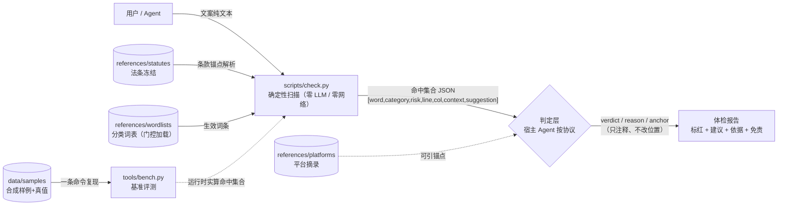

# 03 - 架构与技术选型

**上游**：`plan/02-需求解读.md`（FR 清单）· `plan/01-题目文档.md`（§2 任务要求）
**本文作用**：定分层架构、数据流、目录结构、技术选型与确定性边界——即"系统长什么样、为什么这样长"。

---

## 1. 分层架构与数据流



**四条职责分离线**（架构的骨架，也是验收门）：

1. **规则与代码分离**：规则数据只定义在 `references/`（一处定义、多处引用）；代码不内嵌任何词表词面（M5 起有门禁测试锁定）。
2. **扫描与判定分离**：扫描层确定性（无 LLM、无随机）；判定层只对**已命中候选**作语境注释，不得新增/删除/移动命中（只改 `verdict` 类字段）。
3. **基准与引擎分离**：真值库只存"输入与期望"（禁 `observed` 类字段）；观测由基准运行器**运行时实算**。
4. **运行与工具分离**：用户通路只有 `scripts/check.py`；`tools/` 是构建/校验/基准辅助脚本（不进运行通路，用户无需调用）。

---

## 2. 目录结构（目标形态）

```
ad-copy-compliance-skill/
├── SKILL.md                     ✅ 骨架草案（M5 定稿；契约与 check.py 逐字段一致）
├── README.md                    ✅ 已更新（安装/快速开始/路线图/免责）
├── LICENSE                      ✅ MIT
├── .gitattributes               ✅ 源码 LF 归一 + 冻结件 -text
├── .gitignore                   ✅
├── requirements-dev.txt         ✅ 开发/测试依赖（pytest、pyyaml）——运行时不装任何依赖
├── .github/workflows/ci.yml     ✅ CI（windows×{3.8,3.12} + ubuntu×{3.12}）
├── plan/                        ✅ 00–07 + HANDOFF-M*.md（跨会话交接）
├── references/
│   ├── README.md                ✅ 三层规则包说明
│   ├── statutes/                ⬜ M1：法条冻结（advertising-law / internet-ad-measures /
│   │                            medical-ad-measures，.txt + raw/ + README 来源表 + sha256）
│   ├── platforms/               ⬜ M1：淘宝/抖音/小红书/视频号 人工摘录冻结（.md）
│   ├── wordlists/               ⬜ M1：分类词表（absolute-terms / medical / health-food / industry .json）
│   ├── MANIFEST.json            ⬜ M1：规则包清单（文件 sha256 + 计数 + 版本派生）
│   └── judgment-protocol.md     ⬜ M3：LLM 分层判定协议
├── scripts/
│   └── check.py                 ✅ 骨架版（M2 升级：DFA 化 + 全量测试）
├── data/
│   ├── README.md                ✅ 台账（来源/纪律；M1 回填实测）
│   ├── samples/                 ⬜ M4：cases.json + manifest.json（冻结产物）
│   └── wordlist-candidates.md   ⬜ M1：词表采拒记录（工作台账，非规则包）
├── tools/                       ⬜ M1–M4：build_statutes / validate_rulepack / gen_cases / bench
└── tests/                       ✅ 骨架测试（M2 起逐里程碑扩充）
```

---

## 3. 技术选型与理由

| 决策点 | 选择 | 理由 | 弃选 |
|---|---|---|---|
| 语言 | Python 3.8–3.12（底线 3.8） | 题面固定 `scripts/check.py`；stdlib 文本/JSON 处理成熟；本机 3.8＋3.12 双通道可本地验证 | Node/TS（形态不符；skill 复制即用不需要构建链）、Go（分发形态不符） |
| 运行时依赖 | **零第三方（stdlib only）** | "安装即用"：skill 目录复制即用，无需 pip；CI 干净；供应链面为零；隐私（根本不需要网络栈） | `pyahocorasick` 等（自研 trie/DFA～百行可替代）；`jq`（外部工具） |
| 规则包格式 | JSON（词表/清单）＋纯文本（法条冻结）＋Markdown（平台摘录） | 可 diff / 可校验 / 可审计；中文直接可读 | SQLite（diff 不友好、门禁难做）；YAML（引入解析依赖） |
| 匹配算法 | 自研多模式匹配（trie/DFA；左→右、最长优先、非重叠） | 确定性＋零依赖；百级词表性能充裕；语义可控（最长优先的标红口径） | 单一正则合并（词面转义与最长语义难控） |
| 判定层 | 协议文档＋宿主 Agent 执行（默认无外部 API 通路） | 与 skill 形态契合；隐私友好；可关闭降级 | 内置 API 客户端（默认外发风险——列为扩展，不进首期） |
| 测试 | pytest（dev-only，`requirements-dev.txt` 声明） | 参数化/夹具方便；生态标准 | unittest（工具面弱） |
| CI | GitHub Actions：`windows×{3.8,3.12}`＋`ubuntu×{3.12}` | 底线解释器＋现代解释器各守一档；老解释器只在 windows 守（ubuntu 新镜像对 3.8 支持存疑）；首推后按实况校正并记录 | 四矩阵（留待实测再定） |

---

## 4. 确定性边界（最重要的一张表）

| 环节 | 确定？ | 允许 LLM？ | 说明 |
|---|---|---|---|
| 词表加载/门控 | 确定 | ✗ | 仅 `status=verified` 且锚点可解析的条目生效；被拒条目显式列出 |
| 命中集合/位置 | 确定 | ✗ | 左→右、最长优先、非重叠；同一输入同一集合与位置 |
| 输出与排序 | 确定 | ✗ | 字段序固定；两次运行 stdout 逐字节一致 |
| 替换建议 `suggestion` | 确定 | ✗ | 词表内置映射，不做自由生成 |
| `verdict` / 理由 | **非确定（可复跑性弱）** | ✓（唯一允许处） | 只注释不清洗；不改 `word/line/col`；不可用→全 `uncertain`＋降级声明 |
| 基准比对 | 确定 | ✗ | 真值只存输入与期望；观测运行时实算 |

---

## 5. 测试与 CI 策略

- **本地**：双解释器（`py -3.8` / `py -3.12`）跑全量 `pytest`；CI 矩阵同测。
- **门禁类测试（repo gates）**：`scripts/` 零第三方 import 静态断言；workflow YAML 可解析＋结构断言；`fetch-depth: 0` 断言；词表词面不内嵌断言（M5 起，token 由规则包运行时实算——门禁输入不许是代码字面量）。
- **确定性测试**：同输入两次运行 stdout 逐字节一致。
- **失败路径测试**：缺文件 / 非 UTF-8 / 未知参数 / 词表目录缺失（各自退出码语义）。
- **编码加固三层**：入口 `_ensure_utf8_stdio()`（按 `stream.encoding` 探针）+ CI `PYTHONUTF8=1` + 子进程显式 `encoding`（本项目当前无子进程，口径保留）。
- **变异验证纪律**：新增/改写的守门必须"把被测行为故意弄坏 → 门必须变红"验证一次，防假门。

---

## 6. 版本与标识

- **工具版本**：`scripts/check.py` 的 `__version__`（唯一处）。
- **规则包版本**：由 `references/MANIFEST.json` 内容派生（工具计算，禁手写；M1 定义派生规则）。
- **仓库版本**：`v0.1.0` 起（M6 打 tag）。

---

## 7. 隐私与安全（架构级措施）

- **扫描器零网络**：只允许 stdlib 非网络模块；门禁测试断言 import 白名单，出现网络模块即红。
- **判定默认无外部通路**；降级路径（关闭/不可用→纯扫描或 `uncertain`＋声明）。
- **免责声明**贯穿 SKILL.md、README 与输出（K12）。
- **数据全部本地**；合成数据纪律见 `plan/05` §5。

---

## 8. 已知架构级风险与对策

| 风险 | 对策 |
|---|---|
| 平台摘录获取失败（官方页 JS 渲染） | 降级：如实标注⬜＋注明已查渠道；不阻塞其余模块（扩展期再补） |
| samr 页面结构变化 | 冻结件＋sha256＋"原文逐字包含断言"；重取流程与勘误记录在 `plan/05` |
| 词表误报/漏报争议 | 扫描层只报候选；判定层三态；"零命中≠合规"措辞纪律；建议供人决策 |
| LLM 判定不可复现 | 判定产物与扫描产物分离标注；基准只锁扫描层（deterministic core） |
